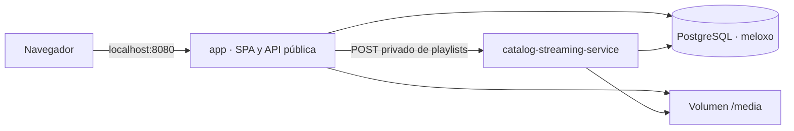

# 02-separacion · Incremento 1 de MELOXO

**Estado de la etapa.** Playlists obtiene los metadatos de canciones mediante HTTP entre dos procesos FastAPI. El navegador sigue entrando por `localhost:8080`. El alcance de este incremento termina en esa consulta.

## Antes y después

Antes, `playlists/service.py` importaba `catalog.public.get_songs` y ejecutaba la consulta de catálogo en el mismo proceso. Ahora, al agregar una canción o abrir una playlist en Compose, usa un cliente HTTP con el nombre de servicio de Docker. La misma función de catálogo resuelve el lote en el proceso receptor.



Los dos procesos comparten temporalmente la base, la credencial de PostgreSQL y los archivos de medios. **Hay separación de procesos; el aislamiento de datos queda pendiente.** El servicio de arranque `migrate` ejecuta las migraciones existentes una vez por arranque del stack y termina. Se conservan los nombres de los volúmenes.

El proceso de catálogo registra los routers de canciones, streaming, medios, importación y compositor, con la autenticación existente. Su healthcheck comprueba que PostgreSQL puede consultar la tabla de canciones. Solo `app` sirve la SPA, crea al primer administrador y ejecuta las tareas periódicas, incluidas la publicación programada y la actualización de Jamendo. Las rutas públicas de catálogo todavía las atiende `app`. Casetes, social, reproducción y analítica conservan sus llamadas actuales.

## Contrato de metadatos

- `POST /internal/catalog/songs/batch` recibe `{"ids": ["<uuid>"]}` y responde `{"songs": [...]}`. Admite hasta 500 UUID por petición. El cliente divide las playlists mayores y conserva el orden de sus pistas al construir la respuesta pública.
- El servicio exige `X-Catalog-Token`, que proviene de `CATALOG_INTERNAL_TOKEN`. Solo se registra la ruta en el catálogo y Compose mantiene su puerto dentro de la red del proyecto.
- Una respuesta válida omite los UUID inexistentes. Agregar uno devuelve `404 song_not_found`. En una playlist que ya contenía una pista eliminada, el título queda visible y la pista figura como no disponible.
- Un fallo de red, timeout, estado HTTP de error o respuesta ilegible da `503 catalog_unavailable` al agregar. Al leer, se devuelve `200`, la copia de metadatos y `degraded: true`. La siguiente lectura vuelve a consultar el servicio y actualiza la copia si cambió.
- Compose fija `CATALOG_SERVICE_URL=http://catalog-streaming-service:8080`. Solo el arranque del monolito con la URL vacía o sin definir usa el modo local. Una petición HTTP fallida nunca activa ese modo. `CATALOG_TIMEOUT_SECONDS` vale 1.5 por defecto.

## Levantar y comprobar

Desde la raíz, prepara `.env` siguiendo [REQUISITOS.txt](../REQUISITOS.txt). Si vienes de la rama anterior, conserva tus valores y agrega una clave independiente para `CATALOG_INTERNAL_TOKEN`.

```sh
docker compose config --quiet
docker compose up -d --build
docker compose ps -a
curl -fsS http://localhost:8080/api/health
docker compose exec -T app python -c "import httpx; print(httpx.get('http://catalog-streaming-service:8080/api/health').json())"
```

Para repetir la prueba de caída con la interfaz y la API:

1. Abre la aplicación, agrega una pista publicada a una playlist tuya y ábrela una vez. También puedes subir y publicar una pista local desde una cuenta de compositor.
2. Obtén el token de tu usuario desde `POST /api/auth/login` en `/api/docs`. En una terminal local, asigna ese token a `TOKEN` y el UUID de la playlist a `PLAYLIST_ID`. Evita compartir esos valores.
3. Ejecuta los comandos siguientes. Las tres lecturas deben mostrar el mismo título y `degraded` debe pasar de `false` a `true` y de vuelta a `false`. `curl` consulta directamente la API para que la caché del navegador no oculte el resultado.

```sh
curl -fsS -H "Authorization: Bearer $TOKEN" "http://localhost:8080/api/playlists/$PLAYLIST_ID"
docker compose logs --tail=10 catalog-streaming-service
docker compose stop catalog-streaming-service
curl -fsS -H "Authorization: Bearer $TOKEN" "http://localhost:8080/api/playlists/$PLAYLIST_ID"
docker compose start --wait catalog-streaming-service
docker compose exec -T app python -c "import httpx; print(httpx.get('http://catalog-streaming-service:8080/api/health').status_code)"
curl -fsS -H "Authorization: Bearer $TOKEN" "http://localhost:8080/api/playlists/$PLAYLIST_ID"
```

Para detener el sistema conservando sus datos usa `docker compose down`.

## Evidencia del 17 de noviembre de 2026

| Comprobación | Resultado |
| --- | --- |
| Suite completa de backend con PostgreSQL 16 | 423 pruebas pasaron, incluidas las tres nuevas pruebas del contrato HTTP |
| Suite del frontend | 143 pruebas de Vitest pasaron en 32 archivos. La imagen compiló la SPA |
| Arranque con Compose | `migrate` terminó con código 0, catálogo quedó `healthy` y su puerto carece de publicación al host |
| Camino de red | El registro del catálogo mostró las peticiones de playlists a `POST /internal/catalog/songs/batch` con respuesta 200. Un UUID inexistente devolvió 404 al agregarlo |
| Caída y regreso | La misma playlist pasó por `degraded: false → true → false`. Durante la caída conservó el título, agregar devolvió 503 y el audio público siguió respondiendo 206 |
| Rutas del proceso independiente | Desde la red de Compose se verificaron el rechazo de un JWT de usuario en la ruta interna (403), el acceso anónimo rechazado en canciones (401), la subida, la publicación y una lectura parcial de 64 bytes (206) |

Después de recrear los contenedores conservando los volúmenes, se verificaron de nuevo la playlist original, el token y el streaming de su MP3. La verificación usó credenciales y volúmenes temporales. Las pruebas de Jamendo usaron respuestas simuladas. La prueba de audio en Docker empleó un MP3 local.

## Archivos de este incremento

**Creados**

- `backend/app/catalog_main.py` — arranque, salud y endpoint privado.
- `backend/app/core/catalog_contract.py` — forma del lote y metadatos compartidos.
- `backend/app/core/catalog_client.py` — selección de transporte y cliente HTTP.
- `backend/tests/modules/playlists/test_catalog_http.py` — autenticación, lotes, errores y recuperación.
- `docs/02-separacion-incremento-1.md` — este informe.
- `REQUISITOS.txt` — instalación y configuración.

**Modificados**

- `backend/app/modules/playlists/service.py` — consultas al cliente y liberación de la conexión antes de esperar.
- `backend/app/modules/catalog/schemas.py` — reutilización de la definición compartida de `SongSummary`.
- `backend/app/core/config.py` y `.env.example` — URL, credencial y timeout del servicio, y versión de la etapa.
- `compose.yaml` — catálogo privado, imagen compartida y orden de arranque.
- `README.md` y `backend/README.md` — topología y comandos actualizados.

## Próximo incremento por revisar

Quedan por decidir el traslado de las rutas públicas y las tareas periódicas de catálogo, y los contratos de autenticación y auditoría que ese traslado necesita. La separación de credenciales, bases y migraciones vendrá después. El balanceo y Redis corresponden a ramas posteriores del PRD.
